# Database Design: PG-Management-SaaS

## 1. Architectural Strategy
The PG-Management-SaaS database implements **Logical Multi-Tenancy with Row-Level Scoping**. Every business table includes an `organization_id` foreign key. Every database query executed by the application enforces this boundary to guarantee zero data leakage between property owners (prevention of OWASP Broken Object Level Authorization / IDOR).

---

## 2. Entity-Relationship Diagram

```mermaid
erDiagram
    ORGANIZATIONS ||--o{ USERS : "employs / registers"
    ORGANIZATIONS ||--o{ PROPERTIES : "owns"
    PROPERTIES ||--o{ ROOMS : "contains"
    ROOMS ||--o{ BEDS : "contains"
    USERS ||--o{ TENANT_STAYS : "occupies"
    BEDS ||--o| TENANT_STAYS : "allocated to"
    TENANT_STAYS ||--o{ RENT_INVOICES : "billed"
    TENANT_STAYS ||--o{ COMPLAINTS : "files"
    USERS ||--o{ AUDIT_LOGS : "triggers"

    ORGANIZATIONS {
        uuid id PK
        varchar name
        varchar contact_email
        varchar contact_phone
        varchar subscription_tier
        boolean is_active
        timestamp created_at
        timestamp updated_at
    }

    USERS {
        uuid id PK
        uuid organization_id FK
        varchar email UK
        varchar phone UK
        varchar password_hash
        varchar first_name
        varchar last_name
        varchar role
        boolean is_active
        boolean is_verified
        int failed_login_attempts
        timestamp lockout_until
        timestamp created_at
        timestamp updated_at
    }

    PROPERTIES {
        uuid id PK
        uuid organization_id FK
        varchar name
        varchar property_type
        varchar address_line1
        varchar city
        varchar state
        varchar postal_code
        varchar emergency_contact
        jsonb amenities
        boolean is_active
        timestamp created_at
        timestamp updated_at
    }

    ROOMS {
        uuid id PK
        uuid property_id FK
        varchar room_number
        int floor_number
        varchar sharing_type
        decimal base_monthly_rent
        boolean has_attached_bathroom
        boolean has_balcony
        boolean is_active
        timestamp created_at
        timestamp updated_at
    }

    BEDS {
        uuid id PK
        uuid room_id FK
        varchar bed_code
        varchar status
        timestamp created_at
        timestamp updated_at
    }

    TENANT_STAYS {
        uuid id PK
        uuid organization_id FK
        uuid user_id FK
        uuid bed_id FK
        date check_in_date
        date expected_check_out_date
        date actual_check_out_date
        decimal agreed_monthly_rent
        decimal security_deposit_amount
        varchar deposit_status
        varchar stay_status
        timestamp created_at
        timestamp updated_at
    }

    RENT_INVOICES {
        uuid id PK
        uuid tenant_stay_id FK
        varchar invoice_number UK
        date billing_month
        decimal base_rent
        decimal utility_charges
        decimal penalty_fee
        decimal total_amount
        decimal paid_amount
        varchar payment_status
        date due_date
        timestamp created_at
        timestamp updated_at
    }

    COMPLAINTS {
        uuid id PK
        uuid property_id FK
        uuid tenant_stay_id FK
        varchar title
        text description
        varchar category
        varchar priority
        varchar status
        uuid assigned_to_user_id FK
        timestamp created_at
        timestamp updated_at
    }

    AUDIT_LOGS {
        uuid id PK
        uuid organization_id FK
        uuid actor_id FK
        varchar action
        varchar entity_name
        varchar entity_id
        varchar ip_address
        varchar user_agent
        jsonb change_diff
        timestamp created_at
    }
```

---

## 3. Detailed Table Specifications

### 3.1 `organizations`
| Column | Type | Constraints | Description |
|---|---|---|---|
| `id` | `UUID` | `PRIMARY KEY, DEFAULT gen_random_uuid()` | Unique Organization ID |
| `name` | `VARCHAR(150)` | `NOT NULL` | Business / PG Chain name |
| `contact_email` | `VARCHAR(255)` | `NOT NULL, UNIQUE` | Owner email |
| `contact_phone` | `VARCHAR(20)` | `NOT NULL` | Contact number |
| `subscription_tier` | `VARCHAR(50)` | `NOT NULL, DEFAULT 'STARTER'` | `STARTER`, `GROWTH`, `ENTERPRISE` |
| `is_active` | `BOOLEAN` | `NOT NULL, DEFAULT true` | Soft deactivation flag |
| `created_at` | `TIMESTAMPTZ` | `NOT NULL, DEFAULT NOW()` | Record creation timestamp |
| `updated_at` | `TIMESTAMPTZ` | `NOT NULL, DEFAULT NOW()` | Record last update timestamp |

### 3.2 `users`
| Column | Type | Constraints | Description |
|---|---|---|---|
| `id` | `UUID` | `PRIMARY KEY, DEFAULT gen_random_uuid()` | Unique User ID |
| `organization_id` | `UUID` | `NULLABLE, FK -> organizations(id)` | Organization scope (NULL for Super Admin) |
| `email` | `VARCHAR(255)` | `NOT NULL, UNIQUE` | Login email address |
| `phone` | `VARCHAR(20)` | `NOT NULL, UNIQUE` | Phone number |
| `password_hash` | `VARCHAR(255)` | `NOT NULL` | BCrypt/Argon2 hashed password |
| `first_name` | `VARCHAR(75)` | `NOT NULL` | First name |
| `last_name` | `VARCHAR(75)` | `NOT NULL` | Last name |
| `role` | `VARCHAR(50)` | `NOT NULL` | `ROLE_SUPER_ADMIN`, `ROLE_PROPERTY_ADMIN`, `ROLE_STAFF`, `ROLE_TENANT` |
| `is_active` | `BOOLEAN` | `NOT NULL, DEFAULT true` | Account active state |
| `is_verified` | `BOOLEAN` | `NOT NULL, DEFAULT false` | Email/KYC verification flag |
| `failed_login_attempts`| `INT` | `NOT NULL, DEFAULT 0` | Counter for brute-force lock |
| `lockout_until` | `TIMESTAMPTZ` | `NULLABLE` | Brute force lockout expiration |
| `created_at` | `TIMESTAMPTZ` | `NOT NULL, DEFAULT NOW()` | Audit timestamp |
| `updated_at` | `TIMESTAMPTZ` | `NOT NULL, DEFAULT NOW()` | Audit timestamp |

---

## 4. Indexing & Security Strategy

1. **Foreign Key Indices**: All FK columns (`organization_id`, `property_id`, `user_id`, `room_id`, `bed_id`) are indexed to eliminate full-table scans during relational joins.
2. **Compound Multi-Tenant Indices**:
   - `idx_users_org_role`: `(organization_id, role)`
   - `idx_properties_org`: `(organization_id, is_active)`
   - `idx_invoices_stay_status`: `(tenant_stay_id, payment_status)`
3. **Password Security**: Never store raw passwords. Use BCrypt cost 12 with per-user salt.
4. **Data Isolation**: Application repository queries must never query by primary key `id` alone when accessing organization resources; they must use `findByIdAndOrganizationId(id, orgId)`.
