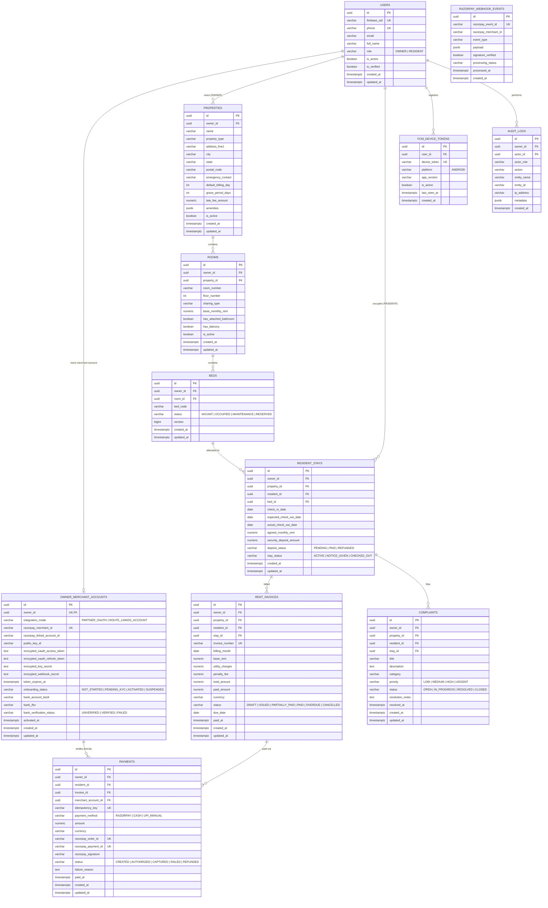

# Database Design: PG Management SaaS

## 1. Multi-Tenant Data Isolation Strategy

The PostgreSQL 16 database implements **Strict Logical Multi-Tenancy with Owner & Resident Scoping**:

1. **Denormalized Tenant Keys (`owner_id` & `resident_id`)**:
   - Every operational table (`properties`, `rooms`, `beds`, `resident_stays`, `rent_invoices`, `payments`, `complaints`, `owner_merchant_accounts`) includes a non-null `owner_id` foreign key referencing `users(id)`.
   - Resident-accessible tables (`resident_stays`, `rent_invoices`, `payments`, `complaints`) additionally carry `resident_id` referencing `users(id)`.
   - This eliminates multi-table joins when validating authorization (`WHERE id = :entityId AND owner_id = :authenticatedOwnerId` or `WHERE id = :entityId AND resident_id = :authenticatedResidentId`).
2. **Defense-in-Depth PostgreSQL Row-Level Security (RLS)**:
   - In addition to JPA repository enforcement, PostgreSQL RLS policies can be bound to session variables (`SET LOCAL app.current_user_id`, `SET LOCAL app.current_role`) so that even raw queries cannot cross tenant boundaries.
3. **Versioned Migrations**:
   - Schema changes are managed via **Flyway** (`db/migration/V1__...sql`, `V2__...sql`) with `spring.jpa.hibernate.ddl-auto: validate` in production.

---

## 2. Entity-Relationship Diagram

---

## 3. Detailed Table Specifications

### 3.1 `users` (Updated for Firebase Phone OTP & 2-Role Model)
| Column | Type | Constraints | Description |
|---|---|---|---|
| `id` | `UUID` | `PRIMARY KEY, DEFAULT gen_random_uuid()` | Internal immutable user UUID |
| `firebase_uid` | `VARCHAR(128)` | `UNIQUE, NULLABLE` | Verified Firebase Auth UID (null for pre-invited residents prior to first OTP login) |
| `phone` | `VARCHAR(20)` | `NOT NULL, UNIQUE` | E.164 phone number (`+91...`) verified by Firebase OTP |
| `email` | `VARCHAR(255)` | `NULLABLE, UNIQUE` | Optional contact email for receipts |
| `full_name` | `VARCHAR(150)` | `NOT NULL` | Display name |
| `role` | `VARCHAR(20)` | `NOT NULL, CHECK (role IN ('OWNER', 'RESIDENT'))` | Strict 2-role isolation |
| `is_active` | `BOOLEAN` | `NOT NULL, DEFAULT true` | Account suspension flag |
| `is_verified` | `BOOLEAN` | `NOT NULL, DEFAULT true` | Verified via Firebase OTP |
| `created_at` | `TIMESTAMPTZ` | `NOT NULL, DEFAULT NOW()` | Creation timestamp |
| `updated_at` | `TIMESTAMPTZ` | `NOT NULL, DEFAULT NOW()` | Last update timestamp |

### 3.2 `owner_merchant_accounts` (Independent PG Owner Razorpay Account)
| Column | Type | Constraints | Description |
|---|---|---|---|
| `id` | `UUID` | `PRIMARY KEY, DEFAULT gen_random_uuid()` | Merchant integration ID |
| `owner_id` | `UUID` | `NOT NULL, UNIQUE, FK -> users(id)` | 1-to-1 binding to PG Owner |
| `integration_mode` | `VARCHAR(30)` | `NOT NULL` | `PARTNER_OAUTH` or `ROUTE_LINKED_ACCOUNT` |
| `razorpay_merchant_id` | `VARCHAR(64)` | `UNIQUE, NULLABLE` | Owner's Razorpay Merchant ID (`merch_...`) |
| `razorpay_linked_account_id` | `VARCHAR(64)` | `UNIQUE, NULLABLE` | Used if onboarded via Route (`acc_...`) |
| `public_key_id` | `VARCHAR(100)` | `NULLABLE` | Public Razorpay Key ID safe to pass to Android Checkout |
| `encrypted_oauth_access_token` | `TEXT` | `NULLABLE` | AES-256-GCM encrypted Razorpay Partner OAuth access token |
| `encrypted_oauth_refresh_token` | `TEXT` | `NULLABLE` | AES-256-GCM encrypted OAuth refresh token |
| `encrypted_key_secret` | `TEXT` | `NULLABLE` | AES-256-GCM encrypted key secret (never exposed) |
| `encrypted_webhook_secret` | `TEXT` | `NULLABLE` | AES-256-GCM encrypted webhook HMAC secret |
| `token_expires_at` | `TIMESTAMPTZ` | `NULLABLE` | OAuth token expiry timestamp |
| `onboarding_status` | `VARCHAR(30)` | `NOT NULL, DEFAULT 'NOT_STARTED'` | `NOT_STARTED`, `PENDING_KYC`, `ACTIVATED`, `SUSPENDED` |
| `bank_account_last4` | `VARCHAR(4)` | `NULLABLE` | Masked last 4 digits of Owner's settlement bank account |
| `bank_ifsc` | `VARCHAR(15)` | `NULLABLE` | Registered bank IFSC |
| `bank_verification_status` | `VARCHAR(20)` | `NOT NULL, DEFAULT 'UNVERIFIED'` | `UNVERIFIED`, `VERIFIED`, `FAILED` |
| `activated_at` | `TIMESTAMPTZ` | `NULLABLE` | Timestamp Razorpay approved live payouts |
| `created_at` | `TIMESTAMPTZ` | `NOT NULL, DEFAULT NOW()` | Audit timestamp |
| `updated_at` | `TIMESTAMPTZ` | `NOT NULL, DEFAULT NOW()` | Audit timestamp |

### 3.3 `rent_invoices`
| Column | Type | Constraints | Description |
|---|---|---|---|
| `id` | `UUID` | `PRIMARY KEY, DEFAULT gen_random_uuid()` | Unique Invoice ID |
| `owner_id` | `UUID` | `NOT NULL, FK -> users(id)` | Multi-tenant Owner scope |
| `property_id` | `UUID` | `NOT NULL, FK -> properties(id)` | PG Property ID |
| `resident_id` | `UUID` | `NOT NULL, FK -> users(id)` | Billed Resident ID |
| `stay_id` | `UUID` | `NOT NULL, FK -> resident_stays(id)` | Associated Stay ID |
| `invoice_number` | `VARCHAR(50)` | `NOT NULL, UNIQUE` | Formatted number (e.g. `INV-202611-00042`) |
| `billing_month` | `DATE` | `NOT NULL` | First day of billing month (`2026-11-01`) |
| `base_rent` | `NUMERIC(10, 2)` | `NOT NULL` | Monthly rent amount in INR |
| `utility_charges` | `NUMERIC(10, 2)` | `NOT NULL, DEFAULT 0.00` | Electricity / water add-ons |
| `penalty_fee` | `NUMERIC(10, 2)` | `NOT NULL, DEFAULT 0.00` | Late payment fee |
| `total_amount` | `NUMERIC(10, 2)` | `NOT NULL` | `base_rent + utility_charges + penalty_fee` |
| `paid_amount` | `NUMERIC(10, 2)` | `NOT NULL, DEFAULT 0.00` | Settled amount |
| `currency` | `VARCHAR(3)` | `NOT NULL, DEFAULT 'INR'` | ISO 4217 currency code |
| `status` | `VARCHAR(20)` | `NOT NULL, DEFAULT 'ISSUED'` | `DRAFT`, `ISSUED`, `PARTIALLY_PAID`, `PAID`, `OVERDUE`, `CANCELLED` |
| `due_date` | `DATE` | `NOT NULL` | Rent payment deadline |
| `paid_at` | `TIMESTAMPTZ` | `NULLABLE` | Full settlement timestamp |
| `created_at` | `TIMESTAMPTZ` | `NOT NULL, DEFAULT NOW()` | Audit timestamp |
| `updated_at` | `TIMESTAMPTZ` | `NOT NULL, DEFAULT NOW()` | Audit timestamp |

### 3.4 `payments`
| Column | Type | Constraints | Description |
|---|---|---|---|
| `id` | `UUID` | `PRIMARY KEY, DEFAULT gen_random_uuid()` | Internal Payment ID |
| `owner_id` | `UUID` | `NOT NULL, FK -> users(id)` | Receiving PG Owner ID |
| `resident_id` | `UUID` | `NOT NULL, FK -> users(id)` | Paying Resident ID |
| `invoice_id` | `UUID` | `NOT NULL, FK -> rent_invoices(id)` | Target Invoice ID |
| `merchant_account_id` | `UUID` | `NULLABLE, FK -> owner_merchant_accounts(id)` | Owner merchant account that received funds |
| `idempotency_key` | `VARCHAR(64)` | `NOT NULL, UNIQUE` | Prevents duplicate order/payment creation |
| `payment_method` | `VARCHAR(20)` | `NOT NULL` | `RAZORPAY`, `CASH`, `UPI_MANUAL` |
| `amount` | `NUMERIC(10, 2)` | `NOT NULL` | Transaction amount in INR |
| `currency` | `VARCHAR(3)` | `NOT NULL, DEFAULT 'INR'` | Currency |
| `razorpay_order_id` | `VARCHAR(64)` | `UNIQUE, NULLABLE` | Order ID created on Owner's merchant account (`order_...`) |
| `razorpay_payment_id` | `VARCHAR(64)` | `UNIQUE, NULLABLE` | Razorpay Payment ID (`pay_...`) |
| `razorpay_signature` | `VARCHAR(255)` | `NULLABLE` | Verified checkout signature |
| `status` | `VARCHAR(30)` | `NOT NULL, DEFAULT 'CREATED'` | `CREATED`, `AUTHORIZED`, `CAPTURED`, `FAILED`, `REFUNDED` |
| `failure_reason` | `TEXT` | `NULLABLE` | Sanitized gateway failure code/description |
| `paid_at` | `TIMESTAMPTZ` | `NULLABLE` | Capture timestamp |
| `created_at` | `TIMESTAMPTZ` | `NOT NULL, DEFAULT NOW()` | Audit timestamp |
| `updated_at` | `TIMESTAMPTZ` | `NOT NULL, DEFAULT NOW()` | Audit timestamp |

---

## 4. Indexing & Uniqueness Constraints

1. **Multi-Tenant Query Indices**:
   - `idx_properties_owner`: `(owner_id, is_active)`
   - `idx_rooms_owner_prop`: `(owner_id, property_id, is_active)`
   - `idx_beds_owner_room_status`: `(owner_id, room_id, status)`
   - `idx_stays_owner_status`: `(owner_id, stay_status)`
   - `idx_stays_resident`: `(resident_id, stay_status)`
   - `idx_invoices_owner_status`: `(owner_id, status, due_date)`
   - `idx_invoices_resident_status`: `(resident_id, status)`
   - `idx_payments_owner_date`: `(owner_id, paid_at DESC)`
   - `idx_complaints_owner_status`: `(owner_id, status, priority)`
   - `idx_complaints_resident`: `(resident_id, created_at DESC)`
2. **Idempotency & Anti-Double-Billing Constraints**:
   - Unique index on `rent_invoices(stay_id, billing_month)` where `status != 'CANCELLED'` prevents generating two invoices for the same stay in the same month.
   - Unique index on `resident_stays(bed_id)` where `stay_status = 'ACTIVE'` enforces at the PostgreSQL level that two active residents can never occupy the same bed simultaneously.
   - Unique constraints on `payments(idempotency_key)`, `payments(razorpay_order_id)`, `payments(razorpay_payment_id)`, and `razorpay_webhook_events(razorpay_event_id)` prevent duplicate ledger updates.
