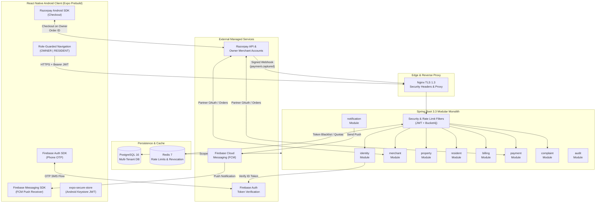
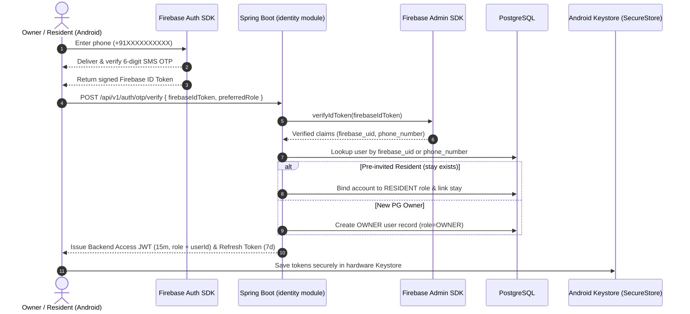
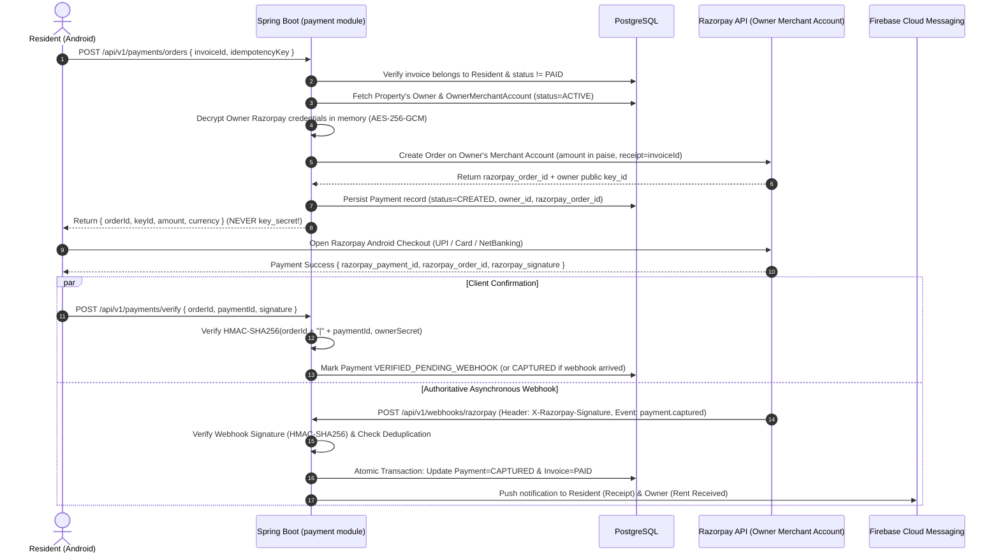

# System Architecture: PG Management SaaS

## 1. High-Level Architectural Overview

PG Management SaaS is designed as a **Modular Monolithic Spring Boot Backend** paired with a **React Native Android Mobile Client**, backed by a **Multi-Tenant PostgreSQL 16 Database** and **Redis 7**.

The architecture adheres to three core principles:
1. **Strict Multi-Tenant Data Isolation**: Zero cross-owner or cross-resident data leakage via JWT-bound tenant scoping.
2. **Independent PG Owner Merchant Settlement**: Resident rent payments settle directly into each PG Owner's own Razorpay merchant account and registered bank account without the SaaS platform acting as a payment custodian.
3. **Zero-Trust Security**: Stateless HMAC-SHA512 JWTs validated after Firebase Phone OTP verification, Bucket4j rate limiting, and AES-256-GCM encryption for stored merchant credentials.

---

## 2. Modular Monolithic Spring Boot Backend

Rather than introducing premature microservice network latency and distributed transaction complexity, the backend uses a **Modular Monolith** structure inside `backend/src/main/java/com/pgmanagement/saas/`.

### 2.1 Vertical Domain Modules

| Module Package | Responsibilities | Internal Encapsulation & Events |
|---|---|---|
| `modules.identity` | Firebase ID Token verification, User account lifecycle, `OWNER` / `RESIDENT` role binding, JWT Access & Refresh token issuance. | Publishes `UserRegisteredEvent` |
| `modules.merchant` | Independent PG Owner Razorpay onboarding, OAuth token / encrypted key management, KYC & bank verification status tracking. | Exposes `MerchantAccountPort` (returns decrypted per-owner credentials only to `payment` module in memory) |
| `modules.property` | CRUD for PG Properties, Rooms, and Beds; availability queries; optimistic bed allocation locking (`@Version`). | Exposes `PropertyQueryService` & `BedAllocationService` |
| `modules.resident` | Resident onboarding by phone number, active stay lifecycle, check-in / notice / check-out workflows. | Publishes `ResidentOnboardedEvent`, `ResidentCheckedOutEvent` |
| `modules.billing` | Scheduled monthly rent invoice generation, ad-hoc invoice adjustments, due date & late fee calculations. | Publishes `InvoiceIssuedEvent`, `InvoiceOverdueEvent` |
| `modules.payment` | Per-owner Razorpay Order creation, HMAC signature verification, Webhook ingestion, idempotent transaction ledger. | Publishes `PaymentCapturedEvent`, `PaymentFailedEvent` |
| `modules.complaint` | Resident maintenance ticket submission, owner assignment, status transitions, resolution notes. | Publishes `ComplaintCreatedEvent`, `ComplaintStatusUpdatedEvent` |
| `modules.notification` | FCM device token registry, `@Async` event listeners converting domain events into FCM push payloads. | Consumes domain events asynchronously |
| `modules.audit` | Append-only audit trail recording financial mutations, merchant onboarding changes, and security events. | Consumes `@Async` audit events |
| `shared` | Cross-cutting security filters (`SecurityConfig`, `RateLimitingFilter`, `JwtTokenProvider`), `TenantContext`, `AesGcmEncryptor`, `GlobalExceptionHandler`. | Zero business logic |

### 2.2 Module Boundary Rules
- **No cross-module Repository access**: For example, `modules.billing` MUST NOT `@Autowired` `StayRepository` directly from `modules.resident`; it calls a public service interface (`ResidentStayQueryService`) or reacts to domain events.
- **Database Integrity**: All tables reside in a single PostgreSQL database with ACID foreign-key guarantees and Flyway schema migrations.

---

## 3. Authentication & Security Flow (Firebase Phone OTP -> Backend JWT)

Firebase Phone OTP handles SMS delivery and OTP verification natively on Android, while Spring Boot remains the sole authority for application authorization, role assignment, and multi-tenant scoping.

### Key Security Controls in Auth
1. **Zero Client Role Spoofing**: If a phone number was already onboarded by an Owner as a `RESIDENT`, backend forces `RESIDENT` role regardless of client payload.
2. **Backend JWT Independence**: Backend issues its own HMAC-SHA512 signed JWT containing `sub` (`userId`), `role` (`OWNER` or `RESIDENT`), and `firebaseUid`. All subsequent API requests are verified locally without calling Firebase on every HTTP request.
3. **Token Revocation**: Refresh tokens and logged-out tokens are tracked in Redis for immediate invalidation.

---

## 4. Independent PG Owner Merchant-Account Architecture (Razorpay)

To ensure rent settles **directly into each PG Owner's own Razorpay merchant account and registered bank account** (subject to Razorpay's approved integration and onboarding process) without the SaaS platform holding resident funds in escrow, the architecture isolates payment credentials and order execution per PG Owner.

### 4.1 Approved Razorpay Integration Models

#### Primary Model: Razorpay Partner OAuth 2.0 (Direct Independent Merchant)
1. **Partner App Registration**: The PG Management SaaS platform registers as an approved **Razorpay Partner**.
2. **Owner Onboarding**:
   - Inside the Owner app (`Merchant Setup`), the Owner initiates Razorpay connection.
   - If the Owner already has an approved Razorpay account (with completed KYC & registered bank account), they authorize the SaaS app via **Razorpay Partner OAuth 2.0**.
   - If the Owner is new to Razorpay, they complete Razorpay's official Partner referral / Co-branded KYC & bank onboarding flow.
3. **Credential Storage**:
   - Razorpay returns `razorpay_merchant_id`, `oauth_access_token`, `oauth_refresh_token`, and `public_key_id`.
   - Spring Boot `merchant` module encrypts tokens using **AES-256-GCM** (authenticated encryption with a 256-bit Master Key from environment/KMS) before persisting in `owner_merchant_accounts`.
4. **Order Execution & Direct Settlement**:
   - When a Resident taps "Pay Rent", the backend creates a Razorpay Order (`POST /v1/orders`) **authenticated as that specific Owner's Razorpay merchant account**.
   - Razorpay processes the payment directly inside the **Owner's merchant account** and settles funds directly into the **Owner's registered bank account** per Razorpay's standard settlement cycle.

#### Secondary Supported Model (Fallback Adapter): Razorpay Route / Linked Accounts
- Should the platform choose Razorpay Route under an approved Marketplace/Partner agreement, the `MerchantAccountPort` interface can alternatively store `razorpay_linked_account_id` (`acc_xxxx`) and attach a 100% transfer instruction (`on_hold: false`) to the Order so funds route directly to the Owner's bank account upon capture.

### 4.2 End-to-End Rent Payment Sequence

### 4.3 Critical Payment Safeguards
1. **Onboarding Gate**: An Owner cannot publish or accept online payments for a PG property unless `owner_merchant_accounts.onboarding_status == 'ACTIVATED'` and `bank_verification_status == 'VERIFIED'`.
2. **Zero Secret Exposure**: Only the Owner's `public_key_id` and generated `order_id` are ever returned to the Resident Android app. `access_token`, `key_secret`, and `webhook_secret` remain strictly encrypted in the backend.
3. **Authoritative Ledger State**: Payment capture is confirmed via cryptographic HMAC signature + Razorpay Webhook (`payment.captured`). Duplicate webhooks are safely ignored using unique constraint on `razorpay_event_id` and `razorpay_payment_id`.

---

## 5. Multi-Tenant Data Isolation Architecture

Every business record in PostgreSQL enforces logical isolation using two non-negotiable rules:

1. **JWT-Derived Identity Only**:
   - The `TenantContext` holds `authenticatedUserId` and `authenticatedRole` populated solely from the validated JWT in `JwtAuthenticationFilter`.
   - Any request body field attempting to pass `ownerId` or `residentId` is ignored or rejected.

2. **Mandatory Query Scoping**:
   - **OWNER Requests**: Every JPA query and native query appends `AND owner_id = :authenticatedUserId`. Accessing a property, room, bed, invoice, or complaint belonging to another owner returns `404 Not Found` or `403 Forbidden` (preventing IDOR enumeration).
   - **RESIDENT Requests**: Every query appends `AND resident_id = :authenticatedUserId` and verifies active stay assignment. Residents can never list other residents in the same PG or view other properties.

---

## 6. React Native Android Architecture

### 6.1 Expo Prebuild / Native Android Configuration
Inspection of `mobile/package.json` confirmed Expo `~52.0.0` with React Native `0.76.3`. Because **Firebase Phone Auth** (`@react-native-firebase/auth`), **Firebase Cloud Messaging** (`@react-native-firebase/messaging`), and **Razorpay Android Checkout** (`react-native-razorpay`) require native Android SDK bridges (`google-services.json`, AndroidManifest permissions, Gradle dependencies), the mobile build strategy transitions from Expo Go to **Expo Prebuild (`npx expo prebuild --platform android`) + `expo-dev-client`**.

### 6.2 Role-Based Navigation Tree
- `RootNavigator`: Observes `AuthContext` (`isAuthenticated`, `user.role`, `isLoading`).
  - Unauthenticated -> `AuthNavigator` (`PhoneInputScreen` -> `OtpVerifyScreen` -> `RoleOnboardingScreen`)
  - `user.role === 'OWNER'` -> `OwnerNavigator` (Bottom Tabs: `Dashboard`, `Properties`, `Residents`, `Billing`, `More/Complaints/MerchantSetup`)
  - `user.role === 'RESIDENT'` -> `ResidentNavigator` (Bottom Tabs: `MyPG`, `Invoices`, `Complaints`, `Profile`)

### 6.3 Official UI Color Palette
All mobile components consume centralized tokens from `mobile/src/theme/colors.ts` enforcing the 60-30-10 rule:
- **60% Primary**: Ice Blue (`#EAF6FF`)
- **30% Secondary**: Midnight Navy (`#142B4A`)
- **10% Accent**: Tangerine (`#FF8C42`)

---

## 7. Firebase Cloud Messaging (FCM) Pipeline

1. **Registration**: Upon successful OTP login, Android requests notification permission (`POST_NOTIFICATIONS` on Android 13+), obtains the FCM registration token, and sends `POST /api/v1/notifications/devices` (`{ token, platform: "ANDROID", appVersion }`).
2. **Dispatch**: The `notification` module listens asynchronously (`@TransactionalEventListener(phase = AFTER_COMMIT)`) to domain events (`InvoiceIssuedEvent`, `PaymentCapturedEvent`, `ComplaintStatusUpdatedEvent`, `ComplaintCreatedEvent`).
3. **Reliability**: Ensures notifications are only dispatched *after* PostgreSQL commits the business transaction. Invalid/unregistered FCM tokens returned by Firebase (`UNREGISTERED`) are pruned automatically from `fcm_device_tokens`.
